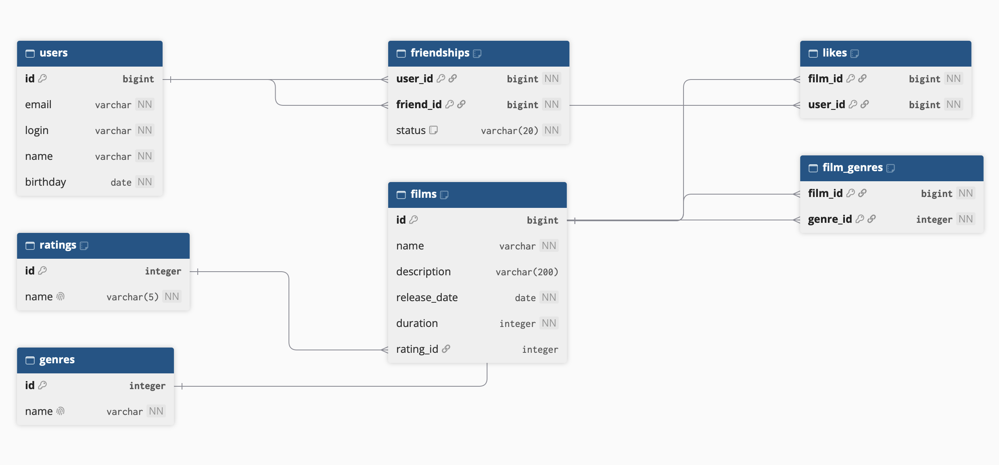

# Filmorate

## Схема базы данных



`users` хранит пользователей, `films` — фильмы. Справочники `ratings` и `genres`
содержат возрастные рейтинги MPA и жанры. Таблица `film_genres` связывает фильмы
с жанрами, `likes` хранит лайки, а `friendships` — связи между пользователями.
У фильма может быть несколько жанров и один возрастной рейтинг;
пока рейтинг не указан, `films.rating_id` может быть `NULL`.

Каждая ячейка содержит одно значение. Названия жанров и рейтингов хранятся
в справочниках и не дублируются в фильмах. Составные первичные ключи в таблицах
связей не позволяют повторно добавить ту же пару идентификаторов.

Дружба направленная: первая заявка создаёт строку `(user_id, friend_id)` со статусом
`UNCONFIRMED`. При встречном добавлении появляются две строки со статусом `CONFIRMED`.
При удалении своей связи встречная, если она есть, становится неподтверждённой.
Запросы друзей и общих друзей ниже учитывают все исходящие связи.

### Примеры запросов

Числа `1`, `2` и `10` ниже — примеры идентификаторов и размера выборки.

Все фильмы с возрастным рейтингом:

```sql
SELECT f.id, f.name, f.description, f.release_date, f.duration,
       r.name AS rating
FROM films AS f
LEFT JOIN ratings AS r ON r.id = f.rating_id
ORDER BY f.id;
```

Жанры фильма с ID 1:

```sql
SELECT g.id, g.name
FROM genres AS g
JOIN film_genres AS fg ON fg.genre_id = g.id
WHERE fg.film_id = 1
ORDER BY g.id;
```

Все пользователи:

```sql
SELECT id, email, login, name, birthday
FROM users
ORDER BY id;
```

Десять наиболее популярных фильмов, включая фильмы без лайков:

```sql
SELECT f.id, f.name, COUNT(l.user_id) AS likes_count
FROM films AS f
LEFT JOIN likes AS l ON l.film_id = f.id
GROUP BY f.id, f.name
ORDER BY likes_count DESC, f.id
LIMIT 10;
```

Друзья пользователя с ID 1 и статусы связей:

```sql
SELECT u.id, u.email, u.login, u.name, u.birthday, f.status
FROM friendships AS f
JOIN users AS u ON u.id = f.friend_id
WHERE f.user_id = 1
ORDER BY u.id;
```

Общие друзья пользователей с ID 1 и 2:

```sql
SELECT u.id, u.email, u.login, u.name, u.birthday
FROM friendships AS first_user
JOIN friendships AS second_user
    ON first_user.friend_id = second_user.friend_id
JOIN users AS u ON u.id = first_user.friend_id
WHERE first_user.user_id = 1
  AND second_user.user_id = 2
ORDER BY u.id;
```
